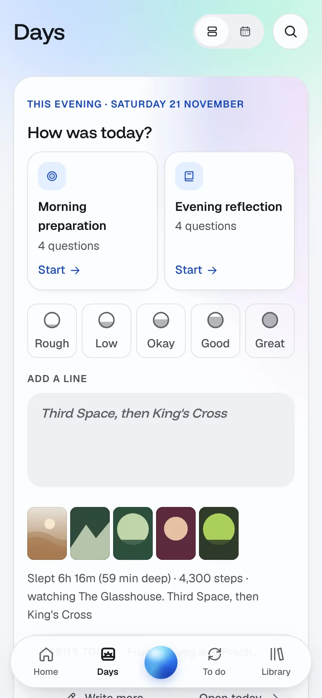

<p align="center">
  
</p>

<h1 align="center">Athena</h1>

<p align="center">
  A personal second brain that you host yourself, on your own Netlify site.
</p>

<p align="center">
  <a href="https://app.netlify.com/start/deploy?repository=https://github.com/matthojo/athena"></a>
</p>

<p align="center">
  <a href="LICENSE"></a>
  
  
</p>

<p align="center">
  
</p>

Athena keeps your notes, people, to-dos and days in one Postgres database on
a Netlify site that you own. It collects from the accounts you connect, such
as Gmail, Calendar, Slack and Linear, and Claude answers questions about all
of it, with sources. You can use it from your phone, your Mac or any
MCP client.

Each copy belongs to one person and runs on their own Netlify account, so
the project never sees your data.

<p align="center">
  
  &nbsp;
  
  &nbsp;
  
</p>

<p align="center"><sub>Screens from sample mode. Every person and number in them is made up.</sub></p>

## What it does

- **Linked notes, people and to-dos:** along with projects, places,
  organisations, events, reminders, goals, habits, saved links, recipes, and
  things to watch and read. A note that mentions someone shows up on their
  page.
- **Ask:** "What did Gayle say about pricing last month?" Claude searches
  your notes and, live, the accounts you've connected. It answers in a few
  sentences with numbered sources, and checks each source against what
  Athena found. It also carries out instructions ("Remind me to call Mum on
  Sunday at 6", "I owe Ricardo the staging plan") and lists every change
  with **Undo**.
- **Days:** a daily log of sleep and steps (from Apple Health, Oura, Strava
  or Withings), habits, mood, a journal, where you went (Google Maps
  Timeline, Swarm), and what you watched, read and listened to.
- **Collections:** Athena signs in to Gmail, Google Calendar, Outlook,
  Granola, Linear, Slack, GitHub, Notion or any MCP server, with read-only
  tools, and on a schedule Claude turns what's new into notes, to-dos and
  events.
- **Team:** assistants you set up, which run on a schedule or when something
  arrives (a new Linear issue, a saved link). A change you haven't allowed
  waits for your **Go**.
- **A morning briefing and reminders:** a note at 07:30 in your time zone,
  and push notifications, including on iPhone once Athena is on your Home
  Screen.
- **Voice:** dictation in notes and spoken questions in Ask. With your own
  ElevenLabs key, **Talk** answers out loud.
- **Works offline:** it installs as an app and keeps a copy on the device.
  Changes made offline are sent when you're back online.
- **Open to your other tools:** an MCP server for Claude, a REST API, iPhone
  Shortcuts and a browser extension (with keys that can only add things),
  and an Obsidian-compatible markdown export.

The [guide](GUIDE.md) goes through each of these in detail.

## Your data stays on your site

- **Your own keys:** your site has its own database and keys, and the keys
  live only in its Netlify environment.
- **Encrypted at rest:** what you write is stored encrypted with AES-256-GCM,
  under a key only your production functions hold. Deploy previews get a
  copy of the database but not the key, so they show "Encrypted — open on
  your-site" instead of your content.
- **Sensitive figures sealed apart:** health, location, money and home
  figures go in a table of their own and are opened only when a page asks
  for them. Ask can read spending only after you switch that on.
- **Read-only access to your accounts:** collections get only read-only
  tools, and anything that sends, edits or deletes is never offered to
  Claude. Account sign-ins are sealed under a second key.
- **Not end to end:** your server holds the keys, so someone with both your
  Netlify environment and your database could read your data.

[SECURITY.md](SECURITY.md) has the full model, including what it doesn't
cover. Athena is a personal tool. It hasn't had an
independent audit, and it doesn't claim to meet HIPAA or any other
compliance standard.

## Deploy your own

You'll need a Netlify account on a credit-based plan (Netlify Database and
AI Gateway need one), and about ten minutes. Claude runs through Netlify AI
Gateway, so there's no Anthropic key to set up; it uses your Netlify credits.

### 1. Deploy

Press **Deploy to Netlify** above. Netlify sets up a new site from this
repository and asks for four values:

| Variable | What it's for |
|---|---|
| `SITE_PASSWORD` | The password you type to open Athena in a browser. Choose your own. |
| `SESSION_SECRET` | Signs your browser session |
| `MCP_BEARER_TOKEN` | Your master token, for connecting the app and making API keys |
| `CONNECTOR_ENCRYPTION_KEY` | Seals your account sign-ins |

Make each of the last three with `openssl rand -hex 32`. Keep a copy of
`MCP_BEARER_TOKEN`; you'll paste it in step 3. The first deploy creates the
database and sets up its tables.

### 2. Set the data key for production only

This key encrypts your content. Set it for the production context alone, so
deploy previews can't read their copy of your data. With the
[Netlify CLI](https://docs.netlify.com/cli/get-started/), in a clone of your
new site's repository:

```sh
netlify link
KEY="$(openssl rand -hex 32)"
netlify env:set ATHENA_DATA_KEY "$KEY" --secret --context production --scope functions
echo "$KEY"   # save this in your password manager now
unset KEY
```

On a Mac you can keep it in your login Keychain instead of printing it:

```sh
KEY="$(openssl rand -hex 32)" && security add-generic-password -a athena -s ATHENA_DATA_KEY -w "$KEY" \
  && netlify env:set ATHENA_DATA_KEY "$KEY" --secret --context production --scope functions; unset KEY
```

> [!IMPORTANT]
> If you lose this key, you lose your data. Netlify won't show a secret
> again, so keep your own copy somewhere safe.

Then redeploy production (**Deploys → Trigger deploy**) so the functions
pick the key up.

### 3. Sign in

Open your site, type your `SITE_PASSWORD`, choose **Connect** and paste
your `MCP_BEARER_TOKEN`. The app exchanges it for a key of its
own, just for that device, and doesn't keep the token. Do the same on each
device.

### 4. Add what you use

Each of these is optional:

- **Accounts and collections:** Settings → Connectors. Google and Microsoft
  need an OAuth app of your own; the [guide](GUIDE.md#connectors-athena-collects-from-your-accounts-itself)
  walks through it.
- **Notifications:** Settings → Notifications. On iPhone, add Athena to your
  Home Screen first.
- **Claude:** see below.

## Updating

New versions come out as [releases](https://github.com/matthojo/athena/releases).
Settings → About you shows which version you're on, and **Check for updates**
asks GitHub whether there's a newer one.

Your copy updates through a pull request. The **Update Athena** workflow in
your repository checks every Monday, and when there's a new release it opens a
pull request that brings your copy up to it. Netlify builds a deploy preview
of that pull request against a copy of your database, so any new migrations
run there before they reach your live site. Merge it, and Netlify updates your
site.

Set it up once, in your repository on GitHub:

1. **Settings → Actions → General**: under "Workflow permissions", turn on
   **Allow GitHub Actions to create and approve pull requests**.
2. To check straight away: **Actions → Update Athena → Run workflow**.

### Details

- **If a release changes a workflow file,** GitHub's built-in token can't push
  it and the run fails. Add a fine-grained personal access token as a
  repository secret named `ATHENA_UPDATE_TOKEN`, with read and write access to
  Contents, Pull requests and Workflows on your repository.
- **A copy made by the Deploy button has no shared history** with this
  repository, so the update copies the release's files over yours. If you've
  changed Athena's own files, the pull request's diff shows what's replaced.
  A fork or clone shares history, so the release is merged and your changes
  are kept unless they conflict.
- **In a public repository, GitHub pauses scheduled workflows** after 60 days
  without activity. Running it from the Actions tab starts it again.
- **To do it by hand,** run `scripts/update-athena.sh` in a clone of your copy.
  It needs the GitHub CLI to open the pull request; with `ATHENA_PUSH=0` it
  only makes the branch.

## Use it from Claude

Make a key in **Settings → API keys** and choose **Claude only**. It opens
Athena's MCP tools and nothing else. Then, in Claude Code:

```sh
claude mcp add --transport http athena https://<your-site>/mcp \
  --header "Authorization: Bearer <your Claude-only key>"
```

Claude can then search and read your notes, people and to-dos, and add to
them. The MCP tools can't delete anything permanently.

## Try it locally

You don't need an account to look around. Sample mode runs the app in your
browser on made-up data:

```sh
git clone https://github.com/matthojo/athena.git athena
cd athena
npm install
npm run dev:app
```

Open http://localhost:5173 and choose **Continue with sample data**. Ask
works in sample mode for one question: "What did Elena say about pricing?"

To run the functions and MCP server too, use `netlify link` and then
`netlify dev` (http://localhost:8888). It starts a local database of its
own, separate from your site's; set up its tables with
`netlify database migrations apply`. The data key stays on production, so
`netlify dev` never has it: anything encrypted shows as "Encrypted — open
on …".

## Export to Obsidian

```sh
ATHENA_DATA_KEY="$(security find-generic-password -a athena -s ATHENA_DATA_KEY -w)" npm run export:obsidian
```

Run it from your linked clone, with your site's database connection string
in the environment ([SECURITY.md](SECURITY.md) §4). It writes a markdown
vault to `export/obsidian-vault/`, which is git-ignored. It's a one-off
snapshot, not a sync. The files it writes are readable, so keep them
somewhere safe.

## Documentation

- [GUIDE.md](GUIDE.md): Ask, reminders and the briefing, voice, connectors
  and collections, and encryption, in detail
- [ARCHITECTURE.md](ARCHITECTURE.md): how the system fits together, and why
- [SECURITY.md](SECURITY.md): the security model, and how to report a
  vulnerability
- [extension/README.md](extension/README.md): the "Save to Athena" browser
  extension
- [CONTRIBUTING.md](CONTRIBUTING.md): setup, checks, and the rules for
  changes and releases
- [CHANGELOG.md](CHANGELOG.md): what changed in each release

## Contributing

Issues and pull requests are welcome. Please report security problems
privately, as [SECURITY.md](SECURITY.md) describes, not in a public issue.

[CONTRIBUTING.md](CONTRIBUTING.md) covers setup, the checks to run and the
rules every change follows. In short:

```sh
npm run typecheck && npm test && npm run build
```

## License

Athena is free software under the [GNU Affero General Public License
v3.0](LICENSE) or later. You can use, change and share it. If you run a
changed version as a service for other people, you have to offer them its
source code under the same license.
