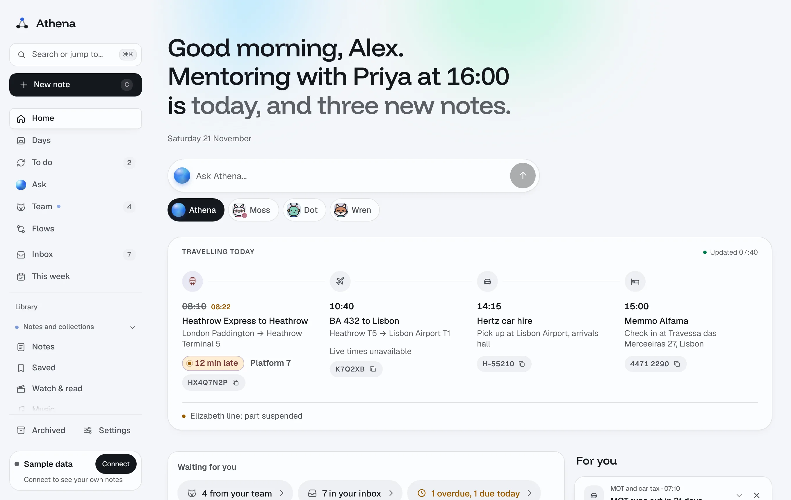
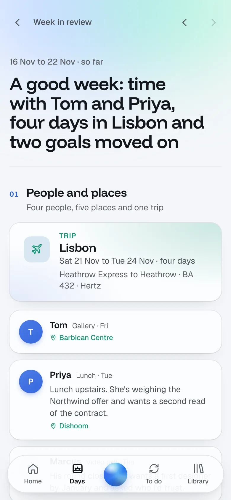
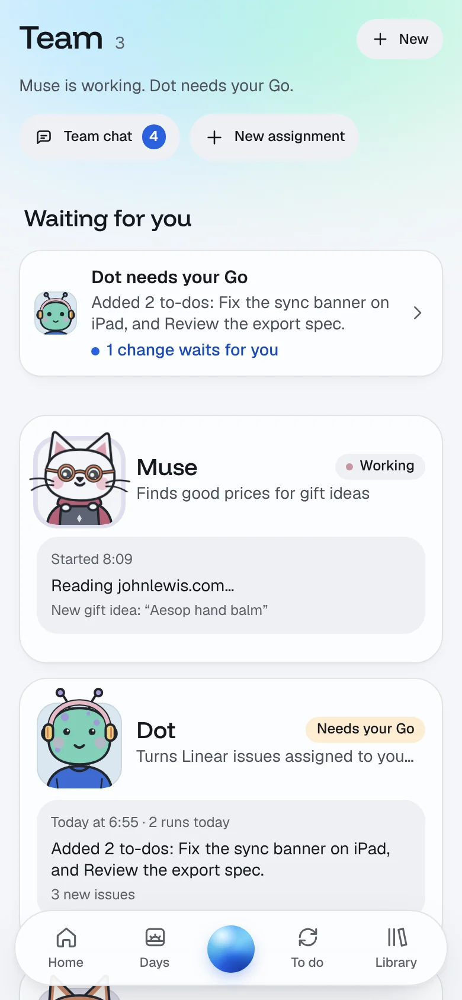
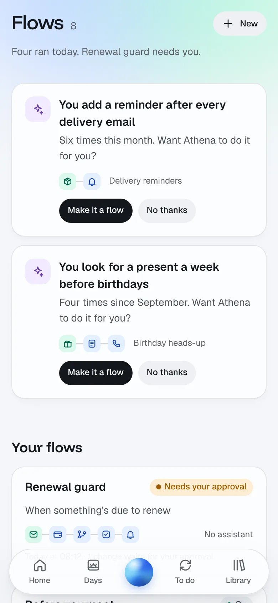
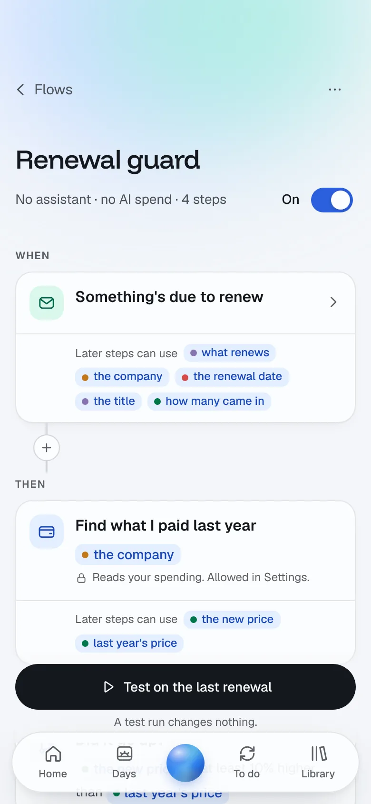
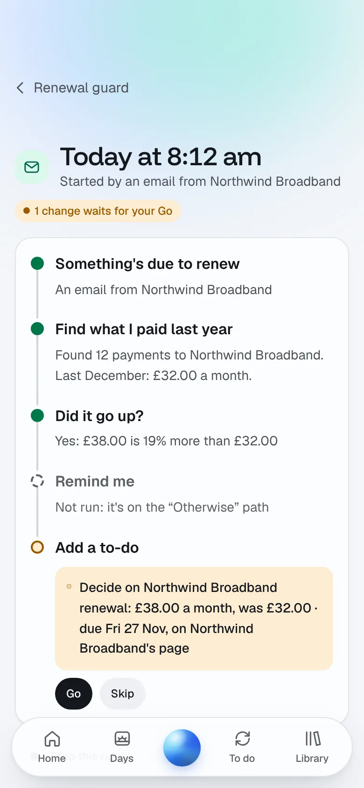

<p align="center">
  
</p>

<h1 align="center">Athena</h1>

<p align="center">
  A personal second brain that you host yourself, on your own Netlify site.
</p>

<p align="center">
  <a href="https://athena-community.netlify.app/docs/"><strong>Documentation</strong></a>
  &nbsp;·&nbsp;
  <a href="https://matthojo.github.io/athena/"><strong>Website</strong></a>
  &nbsp;·&nbsp;
  <a href="https://athena-community.netlify.app/"><strong>Community</strong></a>
</p>

<p align="center">
  <a href="https://app.netlify.com/start/deploy?repository=https://github.com/matthojo/athena"></a>
</p>

<p align="center">
  <a href="LICENSE"></a>
  
  
</p>

https://github.com/user-attachments/assets/79f9c13a-f346-4bd5-8ab0-4c5cd8cc7b23


Athena keeps your notes, people, to-dos and days in one Postgres database on
a Netlify site that you own. It collects from the accounts you connect, such
as Gmail, Calendar, Slack and Linear, and Claude answers questions about all
of it, with sources. You can use it from your phone, your Mac or any
MCP client.

Each copy belongs to one person and runs on their own Netlify account, so
your data stays in that account, not with the project.

<p align="center">
  
</p>

<p align="center">
  
  &nbsp;
  
  &nbsp;
  
</p>

<p align="center">
  
  &nbsp;
  
  &nbsp;
  
</p>

<p align="center"><sub>Screens from sample mode. Every person and number in them is made up.</sub></p>

## What it does

- **Linked notes, people and to-dos:** along with projects, places,
  organisations, events, reminders, goals, habits, saved links, recipes, and
  things to watch and read. A note that mentions someone shows up on their
  page.
- **To-dos with steps:** each to-do opens as a page of its own, with a
  description, steps to tick off, links, a priority, a due date and an area.
- **Ask:** "What did Elena say about pricing last month?" Claude searches
  your notes and, live, the accounts you've connected, then answers in a few
  sentences with numbered sources that Athena checks. It also carries out
  instructions ("Remind me to call Mum on Sunday at 6", "I owe Priya the
  staging plan") and lists every change with **Undo**.
- **Days:** a daily log of sleep and steps, habits, mood, a journal, where you
  went, and what you watched, read and listened to.
- **Collections:** Athena signs in to Gmail, Google Calendar, Outlook,
  Granola, Linear, Slack, GitHub, Notion or any MCP server, and on a schedule
  Claude turns what's new into notes, to-dos and events. Accounts get
  read-only tools unless you switch on something that writes, such as moving
  calendar events.
- **Flows:** a trigger, then steps. "When a renewal email comes in, find what
  I paid last year, and if it's gone up, add a to-do to decide." Adding a
  reminder, a to-do or a line on a list runs on its own; anything else waits
  for your **approval**, and Athena never sends a draft.
- **Team:** assistants you set up, each running its own flows on a schedule or
  when something arrives. Share one as a file, or add one someone shared: it
  joins paused and asks before every change.
- **Community:** assistants, skills, flows, check-in questions, templates and
  themes that other people have shared, each read by a maintainer before it's
  listed. Nothing runs until you add it and switch it on.
- **A morning briefing and reminders:** a note at 07:30 in your time zone,
  and push notifications, including on iPhone once Athena is on your Home
  Screen.
- **Voice:** dictation in notes and spoken questions in Ask. With your own
  ElevenLabs key, **Talk** answers out loud.
- **Works offline:** it installs as an app and keeps a copy on the device.
  Changes made offline are sent when you're back online.
- **Open to your other tools:** an MCP server for Claude, a REST API, iPhone
  Shortcuts, a browser extension, a Raycast extension and an
  Obsidian-compatible markdown export.

The [guide](https://athena-community.netlify.app/docs/guide/) goes through each of these.

## Your data stays on your site

- **Your own keys:** your site has its own database and keys, and the keys
  live in its Netlify environment.
- **Encrypted at rest:** what you write is stored encrypted with AES-256-GCM,
  under a key you set for production functions alone. Deploy previews get a
  copy of the database but not the key, so they show "Encrypted — open on
  your-site" instead of your content, as long as your other keys are kept to
  production too (step 2).
- **Sensitive figures sealed apart:** health, location, money and home
  figures go in a table of their own and are opened only when a page asks
  for them.
- **Read-only by default:** collections get read-only tools unless you switch
  on something that writes. Account sign-ins are sealed under a second key.
- **Not end to end:** your server holds the keys, so someone with both your
  Netlify environment and your database could read your data.

This describes how Athena is designed, not a guarantee. It's a personal tool,
maintained in spare time and provided as is. It hasn't had an independent
audit, and it doesn't claim to meet any compliance standard. The
[security model](https://athena-community.netlify.app/docs/security/) has the detail, including what it doesn't
cover, and [SECURITY.md](SECURITY.md) says how to report a problem.

## Deploy your own

You'll need a Netlify account on a credit-based plan (Netlify Database and AI
Gateway need one), and about ten minutes. Claude runs through Netlify AI
Gateway, so there's no Anthropic key to set up. The
[deploy guide](https://athena-community.netlify.app/docs/start/deploy/) has every step in full.

### 1. Deploy

Press **Deploy to Netlify** above. Netlify sets up a new site from this
repository and asks for `SITE_PASSWORD`, `SESSION_SECRET`, `MCP_BEARER_TOKEN`
and `CONNECTOR_ENCRYPTION_KEY`.

### 2. Keep your keys to production

Set `ATHENA_DATA_KEY` for the production context alone, keep a copy in your
password manager, and redeploy. If you lose this key, you lose your data.

Then, under **Site configuration → Environment variables**, change
`MCP_BEARER_TOKEN`, `CONNECTOR_ENCRYPTION_KEY`, `SESSION_SECRET` and
`SITE_PASSWORD` from every context to **Production** alone. Each update
arrives as a pull request, and Netlify runs its deploy preview before you
merge it, with whatever its context is given. A preview build that can see
one of these stops and says which.

### 3. Sign in

Open your site, type your `SITE_PASSWORD`, choose **Connect** and paste your
`MCP_BEARER_TOKEN`. Each device gets a key of its own.

### 4. Add what you use

Connect accounts under **Settings → Sources**, turn on notifications, and
connect Claude. [Your first week](https://athena-community.netlify.app/docs/start/first-week/) walks through it.

New versions arrive as a pull request in your own repository every Monday
([Updating](https://athena-community.netlify.app/docs/run/updating/)).

## Try it locally

You don't need an account to look around. Sample mode runs the app in your
browser on made-up data:

```sh
git clone https://github.com/matthojo/athena.git athena
cd athena
npm install
npm run dev:app
```

Open http://localhost:5173 and choose **Look around with sample data**.
[Run it locally](https://athena-community.netlify.app/docs/start/run-it-locally/) covers `netlify dev`, with the
functions and a local database.

## Documentation

The docs live on the Community site, with search:

- [Get started](https://athena-community.netlify.app/docs/start/): deploy your own copy and spend your first week
  with it
- [Guide](https://athena-community.netlify.app/docs/guide/): every part of Athena, from Ask to themes
- [Run your copy](https://athena-community.netlify.app/docs/run/): updating, your own keys, costs, backups and
  troubleshooting
- [Reference](https://athena-community.netlify.app/docs/reference/): environment variables, MCP tools, the REST API
  and scheduled jobs
- [Architecture](https://athena-community.netlify.app/docs/architecture/): how the system fits together, for
  contributors
- [Security](https://athena-community.netlify.app/docs/security/): the threat model, encryption and what leaves
  your site
- [Community](https://athena-community.netlify.app/docs/community/): adding items others have shared, and sharing
  your own

## Contributing

Issues, ideas and pull requests are welcome. Ask questions in
[Discussions](https://github.com/matthojo/athena/discussions), and report
security problems privately, as [SECURITY.md](SECURITY.md) describes, not in
a public issue.

[CONTRIBUTING.md](CONTRIBUTING.md) covers setup, the checks to run and the
rules every change follows. In short:

```sh
npm run typecheck && npm test && npm run build
```

By contributing, you accept the
[contribution terms](CONTRIBUTING.md#contribution-terms): you keep your
copyright and grant the maintainer a broad licence, so Athena can also be
offered as a hosted service. Everyone taking part follows the
[Code of Conduct](CODE_OF_CONDUCT.md).

## License

Athena is free software under the [GNU Affero General Public License
v3.0](LICENSE) or later. You can use, change and share it. If you run a
changed version as a service for other people, you have to offer them its
source code under the same license. Every release stays available under it.

The Athena name and logo aren't covered by the license:
[TRADEMARKS.md](TRADEMARKS.md) says how to use them, and what a fork should
do.
